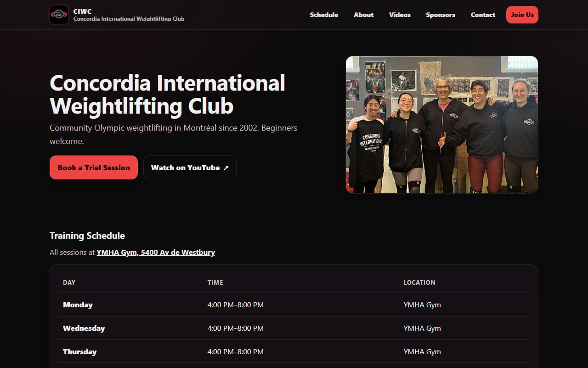
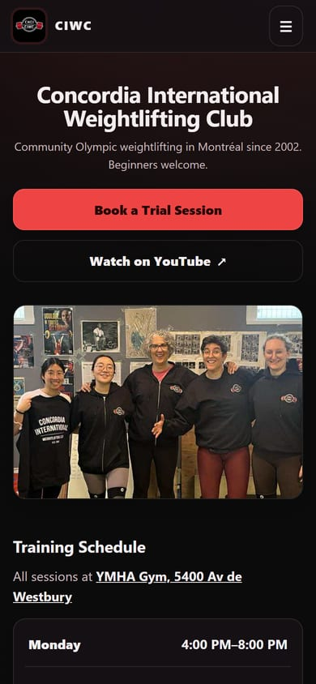
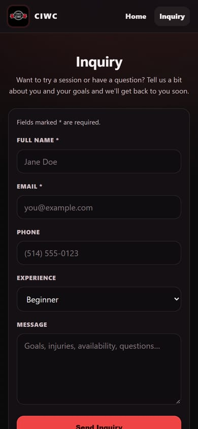

# Concordia International Weightlifting Club website

The website for the Concordia International Weightlifting Club (CIWC), a community Olympic
weightlifting club in Montréal. Live at **[ciweightlifting.ca](https://ciweightlifting.ca)**.

<p>
  
  
  
</p>

## What it does

- **Training schedule and location**: the address opens in Google Maps.
- **Trial and inquiry form** that sends to the club's inbox through [Formspree](https://formspree.io).
  The page doesn't reload; it validates fields, blocks double submits, and shows Formspree's error message if a send fails.
- **YouTube playlist** embed (privacy-enhanced `youtube-nocookie.com`) with a quote panel.
- **Sponsors** section with a "Become a Sponsor" contact link.
- **Search and link previews**: Open Graph and Twitter card tags, a canonical URL, a 1200×630 preview image,
  and `SportsClub` structured data (address and opening hours) generated from the site config.

## Why it's built this way

The club is run by volunteers, so the site has to be cheap to host and easy to keep updated.

- **Plain HTML, CSS and JavaScript, with no framework and no build step.** Anyone can edit a file on GitHub and the
  change goes live. Nothing needs installing and there are no dependencies to keep updated.
- **GitHub Pages** hosts it for free, with a custom domain (`CNAME`).
- **Formspree** handles the form, because GitHub Pages can't run server code. If JavaScript is off, the
  form still submits normally and lands on Formspree's thank-you page.
- **Content lives in one place.** The schedule, sponsors, links and quotes are in the `CONFIG` object at the
  top of [`main.js`](main.js); the page fills itself in from there.

## Updating content

Edit the `CONFIG` block at the top of [`main.js`](main.js). For example:

```js
schedule: [
  { day: "Monday", time: "4:00 PM–8:00 PM", opens: "16:00", closes: "20:00" },
  // `time` is what visitors see; `opens`/`closes` (24h) feed search engines.
],

sponsors: [
  { name: "TD Canada Trust", note: "Queen Mary", logo: "images/sponsor-td.png" },
  // Logos go in images/ as sponsor-<name>.png, ideally square and under ~50 KB.
],

quotes: [
  { text: "Perseverance, Sustained Effort, Ingenuity and Patience.", author: "Lionel St-Jean" },
  // With 2+ quotes, the arrows, dots and auto-rotation switch on.
],
```

The Formspree form ID is the `action` URL in [`inquiry/index.html`](inquiry/index.html).

## Project structure

```
index.html            Home page (schedule, about, videos, sponsors, contact)
main.js               CONFIG + rendering, mobile menu, quote panel, structured data
style.css             Shared styles for all pages
inquiry/              Inquiry form page (index.html, inquiry.css, inquiry.js)
404.html              Not-found page (GitHub Pages serves it automatically)
images/               Photos, icons, sponsor logos
docs/                 Screenshots and project plan
CNAME                 Custom domain for GitHub Pages
```

## Running locally

Serve the folder rather than opening the file directly. The YouTube embed and the root-relative paths
in `404.html` need a real server:

```sh
python -m http.server 8000
# then open http://localhost:8000
```

The VS Code "Live Server" extension works too.

## Accessibility and performance

- Skip link, landmarks, labelled controls, visible focus rings, and touch targets of at least 24px.
- `prefers-reduced-motion` is respected: no smooth scrolling and no quote animation or auto-rotation.
- The phone layout is built for 360–430px screens: compact schedule, a video player capped at one screen, two-column sponsors.
- Images are sized for how they're displayed and carry `width`/`height` to avoid layout shift. The header logo
  went from a 325 KB 1024px PNG to a 9 KB 192px icon, and the About photo from 1.0 MB to 66 KB.
- The YouTube iframe and the images below the fold load lazily.

## Deployment

Every push to `main` deploys to GitHub Pages automatically. Because `main` is the live site, changes are
made on a branch and merged through a pull request.

## Content and credits

Photos, the CIWC logo and sponsor logos belong to the club and to the respective sponsors. They are
not licensed for reuse.

Built and maintained by [@cooliver81](https://github.com/cooliver81).
